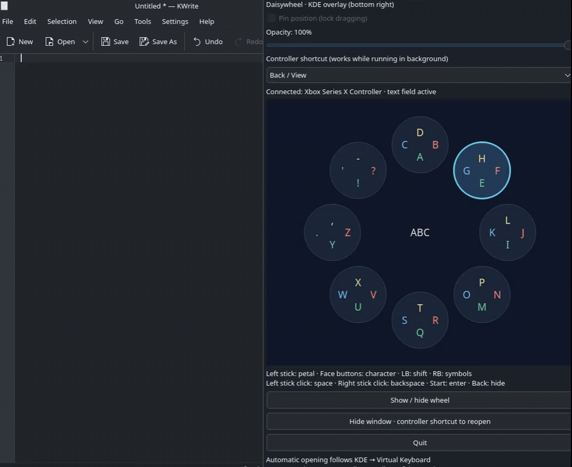
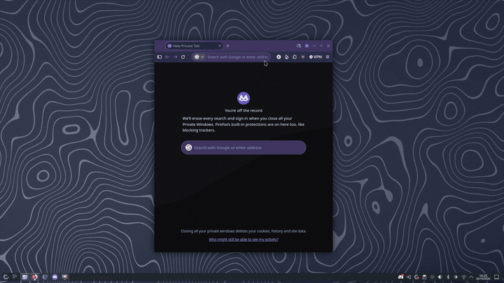
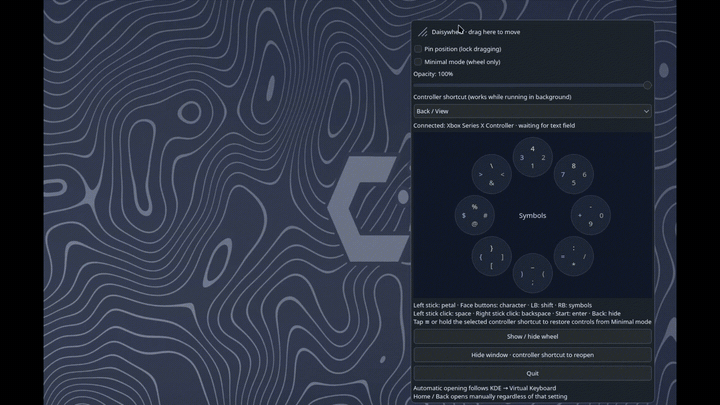
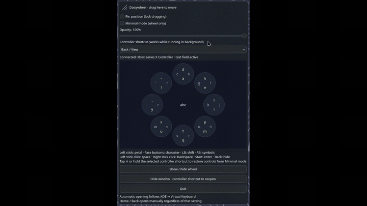

# Daisywheel REAmade

**Controller-first typing for handheld computers and desktop PCs.**

Inspired by Steam's original Daisywheel, REAmade lets you select a petal with the left stick and enter its characters with the four face buttons. Open it with your controller on any display, or let KDE's automatic-opening policy decide when it appears.

It is designed for handheld PCs such as the ROG Ally and Steam Deck, as well as desktop systems running Windows or KDE Plasma on Linux.

## See it in action

The examples below show controller typing, automatic opening on text focus,
Minimal mode with dragging, and the transparency control.

| Controller typing | Opens on text focus |
| --- | --- |
|  |  |

| Minimal mode and dragging | Transparency control |
| --- | --- |
|  |  |

**Current status:** controller typing works in other applications on the
development PCs running Windows and KDE Plasma / Wayland. The v0.2.0 release
adds a guided first-launch installer for the Linux AppImage. Touchscreen devices,
broader application compatibility and Steam Deck Gaming Mode still need testing.
Controller mouse mode, hold-to-repeat Backspace and configurable haptic feedback
are part of the current development build and are planned for the next release.

## Open source and contributing

Daisywheel REAmade is developed in the open. The project license and its terms
are in [LICENSE](LICENSE) ([GPL-3.0-only](https://spdx.org/licenses/GPL-3.0-only.html)).
In plain language, people may use, change and redistribute the project, including
commercially. If they distribute a modified version covered by this license,
they must keep it under GPL-3.0 and provide its corresponding source under the
license terms. Private changes do not need to be published. The full license
text controls. Contributions are welcome; see
[CONTRIBUTING.md](CONTRIBUTING.md) for how to build, report issues and propose
changes. You can also use the GitHub issue and pull request templates.

## Download builds

The [Build packages workflow](https://github.com/Dewopalis/daisywheel-reamade/actions/workflows/packages.yml)
prepares a Windows setup EXE and portable ZIP, a Debian DEB, a Fedora RPM, and a
Linux AppImage.

To download a recent development build, sign in to GitHub, open the workflow
link above, select a successful **Build packages** run, then download the bundle
you need under **Artifacts** at the bottom of the run summary:

- `windows-x64`: setup `.exe` and portable `.zip`
- `linux-debian-appimage`: `.deb` and `.AppImage`
- `linux-fedora-rpm`: `.rpm`

Extract the downloaded artifact ZIP to get the installer or package file inside.
Artifacts are tied to that workflow run and expire after 14 days. They are useful
for trying recent changes; they have not necessarily been manually validated on
handheld hardware.

For reviewed, persistent downloads, visit [GitHub Releases](https://github.com/Dewopalis/daisywheel-reamade/releases).
The v0.2.0 release includes the Windows installer and portable ZIP, Debian DEB,
Fedora RPM, Linux AppImage and SHA-256 checksums. Future version tags build
packages and prepare a draft release for review before publication.

See [installation and release packaging](docs/releases/packaging.md) for supported
platform baselines and release details.

### Install a release

- **Windows:** run the setup `.exe` and follow the installer.
- **Debian-based KDE:** open the downloaded `.deb` with **Discover** and choose
  **Install**. Fedora KDE users can do the same with the `.rpm`.
- **CachyOS / Arch KDE:** open the downloaded `.AppImage`. On first launch,
  choose **Install for this user**. It copies itself to a stable location and
  registers Daisywheel with KDE. If it will not open, right-click it, choose
  **Properties → Permissions**, and enable **Is executable**.

After installing on KDE, open **System Settings → Keyboard → Virtual Keyboard**,
select **Daisywheel REAmade**, and click **Apply**. KDE requires this last choice;
the installer leaves your current keyboard selection unchanged. See the full
[installation guide](docs/releases/packaging.md#install-downloaded-packages) for
other package managers and removal steps. The source-build instructions below
are for developers.

## Platform support

| Platform | Status |
| --- | --- |
| KDE Plasma 6 on Linux / Wayland | Working prototype; primary development target |
| CachyOS / Arch-based KDE distributions | Installation instructions below; more device testing needed |
| Steam Deck Desktop Mode | Intended target; not yet tested on the device |
| Steam Deck Gaming Mode | Separate integration planned for investigation |
| Windows 11 | Controller typing confirmed; UI Automation field detection tested with native and Qt controls |
| GNOME, other Wayland desktops, X11 | System-keyboard integration not supported yet |

## Developer setup: build from source on CachyOS / Arch Linux with KDE

These steps are for developers who want to build the project themselves. Most
people should use one of the release packages above. Avoid mixing a source
installation with a packaged installation: a user-local KDE entry from a source
build can take precedence over the package entry.

Use a **Plasma Wayland** session. Check with `echo "$XDG_SESSION_TYPE"`; it should print `wayland`.

### 1. Install development dependencies

```bash
sudo pacman -Syu --needed base-devel git cmake pkgconf qt6-base qt6-wayland layer-shell-qt wayland sdl2-compat
```

Requirements: C++17, CMake 3.20+, Qt 6.8+ Widgets/Wayland Client/DBus, SDL2, Wayland protocol scanner, and LayerShellQt. No private Qt headers are required. Qt 6.8+ is needed for the protocol generator's `PRIVATE_CODE` option; see [Qt documentation](https://doc.qt.io/qt-6.8/qt-generate-wayland-protocol-client-sources.html). Arch supplies the overlay library through [layer-shell-qt](https://archlinux.org/packages/extra/x86_64/layer-shell-qt/).

Other distributions need equivalent development packages; their installation commands have not been verified yet.

### 2. Clone and build

```bash
git clone https://github.com/Dewopalis/daisywheel-reamade.git
cd daisywheel-reamade
cmake -S . -B build -DCMAKE_BUILD_TYPE=Release
cmake --build build --parallel
ctest --test-dir build --output-on-failure
```

### 3. Test your controller locally

```bash
./build/daisywheel
```

This mode types **only into its own test field**. With an Xbox controller, hold the left stick upward and press A/B/X/Y: the field should receive `a/b/c/d`.

You can inspect controller detection with `./build/daisywheel --controllers`.
**Quit the test instance before enabling system mode**, so two instances do not process the same controller input.

### 4. Install a source build and register it with KDE

Run from the source directory. This installs for your user only:

```bash
install -Dm755 build/daisywheel "$HOME/.local/bin/daisywheel-reamade"
mkdir -p "$HOME/.local/share/applications"
cat > "$HOME/.local/share/applications/org.daisywheel.keyboard.desktop" <<EOF_DESKTOP
[Desktop Entry]
Type=Application
Name=Daisywheel REAmade
Comment=Controller-first keyboard for KDE Wayland
Exec="$HOME/.local/bin/daisywheel-reamade" --kde-input-method
Icon=input-keyboard-virtual
Terminal=false
NoDisplay=true
X-KDE-Wayland-VirtualKeyboard=true
EOF_DESKTOP
kbuildsycoca6 --noincremental
```

The installed executable is named `daisywheel-reamade`; the build output remains `daisywheel`. This stable install path means moving your source checkout will not break KDE's launcher. Runtime libraries must remain installed.

### 5. Enable and configure the source build

1. Open **System Settings → Keyboard → Virtual Keyboard**, or search settings for “Virtual Keyboard.”
2. Select **Daisywheel REAmade** and click **Apply**.
3. Choose your preferred **Show Virtual Keyboard** policy: never automatically, touch/tablet input, or any input. Labels may vary by Plasma version.
4. Focus a text field in another application, press **Home/Guide**, and type with your controller.

KWin launches the selected keyboard. **No separate Autostart entry is needed.** The selection persists across sessions, so launch after logging into Plasma is expected; a full reboot test remains outstanding. This setup does not install a keyboard for the login screen or establish lock-screen support.

## Run on Windows

For normal use, install the Windows setup `.exe` described above. The steps
below cover running and building a development checkout.

### Launch the keyboard

From the repository folder in PowerShell:

```powershell
Start-Process -FilePath '.\build-windows\daisywheel.exe' -ArgumentList '--windows-input'
```

For the current development checkout, you can also run this from any folder:

```powershell
Start-Process -FilePath 'C:\Development\daisywheel-reamade\build-windows\daisywheel.exe' -ArgumentList '--windows-input'
```

Keep the entire `build-windows` directory together: the executable needs its DLLs and plugin folders. Double-clicking the EXE without arguments opens **local test mode**, which types into its own field. For an Explorer/desktop shortcut, use this Target (adjust the path for your installation):

```text
"C:\Development\daisywheel-reamade\build-windows\daisywheel.exe" --windows-input
```

System mode initially runs in the notification area near the clock. Look under the hidden-icons arrow if needed. Press Home/Guide or Back/View, or right-click the Daisywheel tray icon and choose **Show / hide keyboard**. Focus a text field in another app and type with your controller. A chosen shortcut takes precedence over that button's typing action. Only one Windows system-mode instance can run at a time.

### Open automatically when selecting a text field

1. Launch Daisywheel in Windows system mode.
2. Open the wheel and enable **Open automatically when a text field is selected**. You can also enable **Open automatically for text fields** from the tray menu.
3. Click, tap, or tab into an editable text field in another application. The overlay appears without deliberately taking keyboard focus.
4. Move focus to a non-text control or read-only field to hide an automatically opened overlay.

The option is saved between launches. Detection uses Windows UI Automation and direct support for standard native text controls. Native text boxes, Qt text boxes/document editors and password fields have been tested. Browsers and other custom controls can work when they expose suitable accessibility information, but browser compatibility has not yet been validated. Detection checks field metadata and editability; it does not read field contents.

Hiding the overlay suppresses automatic reopening for the same field. Selecting a different field or leaving and returning to text entry restores automatic opening. Opening manually keeps the overlay open until you dismiss it. Controller and tray opening remain available if automatic detection fails. The overlay opens at the bottom right of the foreground application's display, with a pointer-display fallback.

Daisywheel runs as a separate app. It does not register as a replacement touch-keyboard option in Windows Settings or disable Microsoft's keyboard. If both appear, adjust the built-in touch keyboard's automatic-opening preference separately.

### Start automatically when signing in

1. Launch with `--windows-input` and open the wheel.
2. Enable **Start Daisywheel when I sign in to Windows**.
3. Enable the automatic text-field option too if you want the wheel to appear as you select text fields after sign-in.
4. Keep the executable and its companion DLLs at the same location.

This registers the current executable with `--windows-input` for **your Windows account**. Administrator rights are not required. The saved automatic-opening preference is restored on launch. Windows may delay startup slightly; this is sign-in startup, not login-screen keyboard support. A full sign-out/reboot test is still outstanding.

If Windows has disabled the app, check **Settings → Apps → Startup** or **Task Manager → Startup apps** for Daisywheel/DaisywheelREAmade and enable it. See [Microsoft's startup-app instructions](https://support.microsoft.com/en-gb/windows/experience/startup-boot/configure-startup-applications-in-windows).

To remove startup registration, uncheck **Start Daisywheel when I sign in to Windows**. Choosing **Quit** stops the current instance but keeps startup registration and preferences. Turning off automatic opening keeps manual opening available. If you move the app, launch it from the new location and toggle the startup checkbox off and on to update its path.

### Update or remove a Windows installation

Choose **Quit** from the tray before updating; a running instance locks the EXE
on Windows. For a setup installation, run the newer setup EXE to update, or
uninstall Daisywheel from **Settings → Apps → Installed apps**. For the portable
ZIP, replace the whole extracted folder or delete it to remove the app. Before
removing either installation, disable **Start Daisywheel when I sign in to
Windows** and quit the running instance. To update a source build, rebuild and
launch it again with `--windows-input`.

### Build from source

Use a matching **Qt 6 / MinGW 64-bit** pair, CMake 3.20+, Ninja and the SDL2 MinGW 64-bit development package. The branch includes `scripts/build-windows.ps1`; it configures, builds, runs the shared wheel tests and deploys runtime DLLs alongside the executables. Its defaults use dependencies in `work/`; supply `-QtRoot`, `-CompilerRoot`, `-SDLRoot`, `-CMake` and `-Ninja` for other installations.

```powershell
& .\scripts\build-windows.ps1
Start-Process -FilePath '.\build-windows\daisywheel.exe' -ArgumentList '--controllers' -Wait -RedirectStandardOutput '.\build-windows\controllers.txt'
Get-Content '.\build-windows\controllers.txt'
Start-Process -FilePath '.\build-windows\daisywheel.exe' -ArgumentList '--windows-input'
```

Characters, Space, Backspace and Enter go to the current foreground application. Release physical Shift/Ctrl/Alt/Windows keys before typing. Windows can block input to applications running at a higher privilege level. Secure desktops and login screens are unsupported.

Run the interactive tests on an unlocked Windows desktop:

```powershell
.\build-windows\windows-input-tests.exe
.\build-windows\windows-focus-tests.exe
```

The input test uses a separate native Windows text control to check Unicode including a surrogate pair, Backspace, Enter, self-process rejection and overlay focus preservation. The focus test checks native/Qt editable fields, same-window field identities, read-only fields, buttons, document editors and password fields. Both temporarily focus their own verified fixture windows, including a synthetic mouse click; they do not read user text. Reconnects, browsers, elevated applications and handheld displays require additional testing. A Qt text-field probe reordered a mixed Unicode/emoji string injected as one burst; this remains a compatibility issue before adding multi-character Unicode layouts or prediction.

Validated on the Windows development PC: Release build, shared wheel/visibility tests, isolated native input and UI Automation focus tests, local/system-mode smoke tests, and detection of an accessible mapped Xbox controller. The user also confirmed controller-driven typing into another application. See [Windows development notes](docs/windows-development.md).

## Controls

Characters sit at the physical south/east/west/north face-button positions. SDL supplies controller mappings; colors currently follow Xbox conventions.

| Control | Action |
| --- | --- |
| Left stick | Select a petal; neutral does not enter a character |
| A / B / X / Y | Enter the bottom / right / left / top character in the selected petal |
| Left bumper | Toggle uppercase |
| Right bumper | Toggle letters and symbols |
| Left stick click | Space |
| Right stick click / hold | Backspace once / repeat while held |
| Hold left trigger (LT), when mouse mode is enabled | Switch to controller mouse mode in system mode |
| Right stick while holding LT | Move pointer |
| A / B while holding LT | Left-click / right-click |
| X / Y while holding LT | Scroll up / down |
| D-pad up / down while holding LT | Scroll faster up / down |
| Start / Menu | Enter |
| Home / Guide | Show or hide the keyboard by default |
| Back / View | Also show or hide in Windows/KDE system mode |

The shortcut dropdown offers Home/Guide, Back/View and Start/Menu. A chosen shortcut takes precedence over that button's typing action. Steam or desktop bindings may also respond to Guide; select another shortcut if needed. Daisywheel does not suppress those other bindings.

Open **Settings** from the title bar to adjust the window and controller options without adding those controls to the keyboard window. **Minimal mode (wheel only)** shrinks the keyboard for handheld screens; its compact bar keeps both **Settings** and **Show controls** available. You can also hold the selected controller shortcut for about a second to restore the full controls.

## Opening and appearance

In KDE mode, automatic opening follows KDE's **Show Virtual Keyboard** policy through KWin's `willShowOnActive` API. The overlay starts hidden and picks up applied policy changes without restarting. Failed policy queries disable automatic opening. Windows uses its saved Daisywheel automatic-opening option described above.

Controller opening works regardless of the automatic policy and keeps the overlay open until dismissed. Hiding it suppresses automatic reopening in the same input context; leaving that context restores automatic behavior. KDE only commits into an active input context. Windows sends keystrokes to the foreground application; focus a text field first.

| Setting | Current behavior |
| --- | --- |
| Opacity | In **Settings**; 30–100%, saved between launches |
| Controller shortcut | In **Settings**; saved between launches |
| Controller profile | In **Settings**; Handheld, Living room / desktop, or Custom; saved between launches |
| Enable controller mouse mode | In **Settings**; disabled by Handheld and enabled by Living room / desktop |
| Pointer speed | In **Settings**; adjustable and saved between launches |
| Haptic feedback | In **Settings**; optional, strength adjustable, both settings saved between launches |
| Minimal mode | In **Settings**; the compact bar keeps Settings available and **Show controls** restores the full controls |
| KDE system-mode position | Drag the header or corner to see a translucent window outline preview; position and size apply and save on release |
| Drag handle / pin toggle | In **Settings**, enable **Pin position** to lock dragging; otherwise drag the header to move |
| Hide window | Keeps controller handling running |
| Quit | Stops the process; controller reopening requires relaunch |

KWin's `VirtualKeyboard.visible` property describes its native input panel, not this independent overlay; it is not a reliable visibility check for Daisywheel.

Haptic feedback pulses when the controller moves between petals, types a
character, or deletes text. It uses controller rumble support and is disabled
by default.

Controller mouse mode works in Windows and KDE system mode. On KDE, Daisywheel
asks the desktop's RemoteDesktop portal for pointer permission the first time
you hold LT; grant pointer access in the prompt. The portal may remember that
permission across restarts. When mouse mode is active, the overlay is made
click-through so mouse clicks reach the application underneath it.

Unpin the wheel, drag the header to move it, then pin it if you want to lock the
position. Drag the small diagonal grip in the top-left corner to resize. During
a KDE drag, a translucent outline shows the target window position or size; the
layer shell applies it on release to avoid compositor rubber-banding. Minimal
mode also has a compact drag handle next to **Show controls**. Windows and KDE
system mode save position and size between launches. Windows keeps the
position on its monitor and clamps it to the available desktop area after size
or display changes.

## Updating or removing a source build on KDE

These commands apply only to the developer source installation above. For a
DEB, RPM or future guided AppImage installation, use the system's package or
application manager; see the [package installation guide](docs/releases/packaging.md#install-downloaded-packages).

First select **None** in KDE Virtual Keyboard settings and apply to stop the keyboard. From the source checkout:

```bash
git pull --ff-only
cmake -S . -B build -DCMAKE_BUILD_TYPE=Release
cmake --build build --parallel
ctest --test-dir build --output-on-failure
install -Dm755 build/daisywheel "$HOME/.local/bin/daisywheel-reamade"
```

Select Daisywheel REAmade again and apply. Rebuild after dependency updates if the binary stops starting.

To disable it, select None or your previous keyboard and apply. To remove the user installation after disabling:

```bash
rm -- "$HOME/.local/share/applications/org.daisywheel.keyboard.desktop"
rm -- "$HOME/.local/bin/daisywheel-reamade"
kbuildsycoca6 --noincremental
```

## Roadmap

- [x] Controller typing, manual show/hide shortcuts and text delivery to other applications on Windows and KDE Plasma / Wayland.
- [x] KDE Virtual Keyboard integration, including KDE-controlled automatic opening.
- [x] Windows UI Automation text-field detection and optional sign-in startup.
- [x] Move, pin and resize the overlay; Minimal mode and adjustable transparency.
- [x] Add handheld and living-room controller profiles, adjustable pointer speed, mouse controls, hold-to-repeat Backspace, and optional haptic feedback.
- [x] Build and publish v0.2.0 packages for Windows and Linux, including the guided Linux AppImage installer.
- [ ] Validate touch/tablet opening and KDE keyboard policies on supported hardware.
- [ ] Test sign-in/reboot startup, controller reconnection and multiple displays on target systems.
- [ ] Broaden compatibility testing across browsers, editors and XWayland applications on Linux, and more applications and controllers on Windows.
- [ ] Tune the compact layout for handheld screens and controls.
- [ ] Add configurable per-button mappings and stick deadzones.
- [ ] Add more languages, layouts and controller-specific button labels.
- [ ] Test published packages on handhelds, including Steam Deck Desktop Mode and ROG Ally.
- [ ] Investigate Steam Deck Gaming Mode separately.

Windows uses its own activation and input backend. Microsoft's IME API does not provide a general independent replacement touch keyboard; see [Microsoft's IME documentation](https://learn.microsoft.com/en-gb/windows/apps/design/input/input-method-editors).

## Troubleshooting

**No controller:** run `./build/daisywheel --controllers`. Check Linux device detection and session access. Sandboxes may hide input devices even when the host detects them.

**Only types in the test field:** quit local test mode and select the keyboard in KDE settings for system input.

**Doesn't open automatically:** apply your KDE policy, verify a Wayland session, and try Home/Guide with a text field focused. Touch/tablet mode should not open for ordinary mouse input.

**Guide also opens Steam:** choose another shortcut.

**Stopped responding after Quit:** select None and apply, then select Daisywheel REAmade and apply again so KWin launches it.

**Missing from settings:** verify the desktop entry's executable path and `X-KDE-Wayland-VirtualKeyboard=true`, then run `kbuildsycoca6 --noincremental`.

## Implementation and references

Qt Widgets renders the UI and SDL2 handles controllers. KDE system mode uses input-method-v1 for text delivery and a LayerShellQt overlay for display without taking keyboard focus. Normal operation does not retain entered text or put it in diagnostic logs.

This is an original implementation inspired by [DaisyWheelJS](https://github.com/likethemammal/daisywheeljs), [AnyWheel](https://github.com/EvilJagaGenius/AnyWheel) and [KDE Plasma Keyboard](https://github.com/KDE/plasma-keyboard).

Related documentation: [KDE Virtual Keyboard](https://docs.kde.org/stable_kf6/en/kwin/kcontrol/kwinvirtualkeyboard/index.html) and [Windows SendInput](https://learn.microsoft.com/windows/win32/api/winuser/nf-winuser-sendinput).
