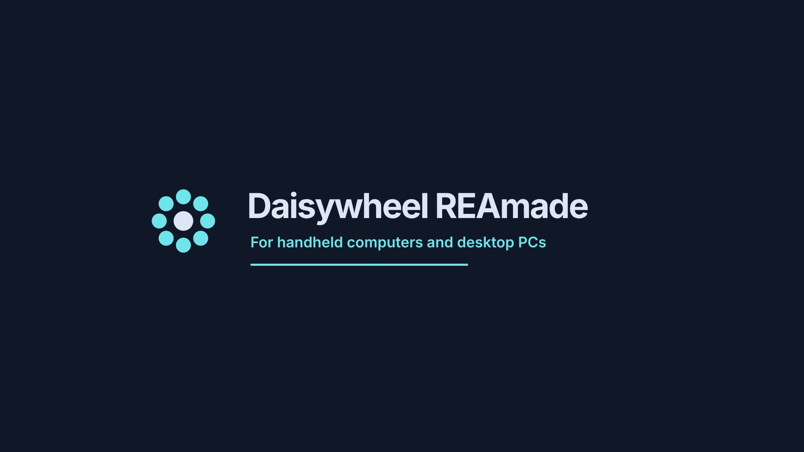
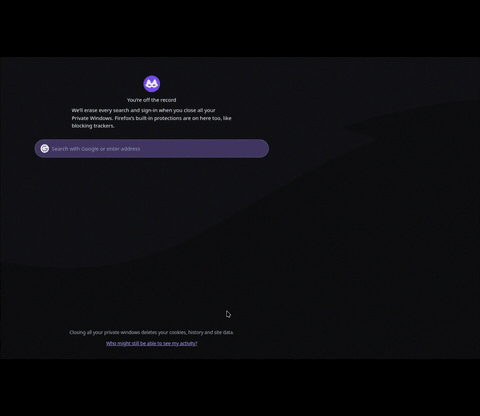
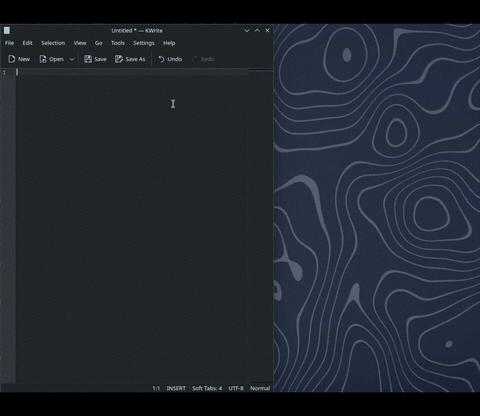
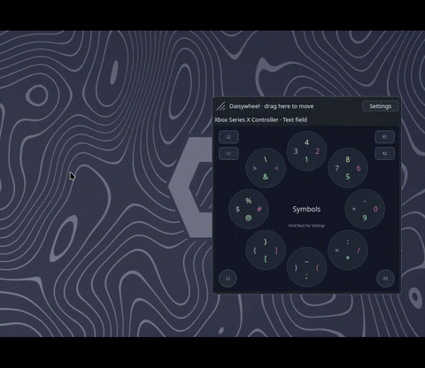
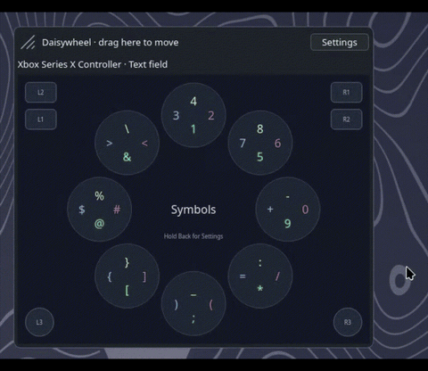
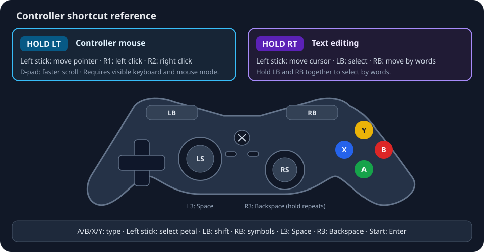

# Daisywheel REAmade

**Controller-first typing for handheld computers and desktop PCs.**

Daisywheel is an on-screen keyboard inspired by Steam's original daisywheel.
Choose a petal with a stick, then enter a character with a face button. It is
being built for Windows and KDE Plasma on Linux, including handhelds and
living-room PCs.

## Why Daisywheel?

Typing from the couch or a handheld often means navigating a full on-screen keyboard with a controller or reaching for a physical keyboard. Daisywheel gives the controller already in your hands a compact way to enter text.

## See it in action

| Opens on text focus | Controller typing |
| --- | --- |
|  |  |

| Dragging and resizing | Controller mouse mode |
| --- | --- |
|  |  |

## Download

Download the [latest release](https://github.com/Dewopalis/daisywheel-reamade/releases/latest):

| System | Package |
| --- | --- |
| Windows | Setup `.exe` installer or portable `.zip` |
| Debian / Ubuntu | `.deb` |
| Fedora | `.rpm` |
| Arch / CachyOS and other Linux distributions | `.AppImage` |
| macOS | Experimental `.dmg` / `.zip` from the latest release; physical Mac testing is still needed |

For macOS, physical Mac testing is still needed. See the [installation guide](docs/installation.md) for setup and update instructions.

## Quick start

- On Windows, run the setup installer and launch Daisywheel from the Start menu.
- On KDE, install the `.deb`, `.rpm` or `.AppImage`, then select **Daisywheel REAmade** in **System Settings → Keyboard → Virtual Keyboard**.
- Open the keyboard with its configured controller shortcut, or focus a text field when automatic opening is enabled.
- Move the left stick to choose a petal and press a face button to type.

## Controls at a glance

| Controller input | Action |
| --- | --- |
| Left stick, face buttons | Choose petal, type character |
| LB / RB | Shift case / switch letters and symbols |
| L3 / R3 | Space / Backspace; hold R3 to repeat |
| Start | Enter |
| Hold RT, move left stick | Move text cursor; hold LB to select or RB to navigate by words |
| Hold LT, move left stick | Controller mouse mode when enabled |
| R1 / R2 while holding LT | Left-click / right-click |

Shortcuts, profiles, deadzones, mouse mode, haptics and sound can be configured in Settings. See [all controls and settings](docs/controls.md).

## Compatibility

Controller typing has been tested on Windows and KDE Plasma on Wayland. The macOS app currently has CI build and launch testing only. Steam Deck, ROG Ally and other handhelds still need device testing. See the [compatibility matrix](docs/compatibility.md), or [submit a test report](https://github.com/Dewopalis/daisywheel-reamade/issues/new?template=compatibility_report.md).

**Next:** harden recovery from interrupted input, test installation upgrades and removal, and expand state-transition coverage. Proposed v1.0 support targets are in the [roadmap](docs/roadmap.md); current results remain in the [compatibility matrix](docs/compatibility.md).

## Open source

Daisywheel REAmade is licensed under [GPL-3.0-only](LICENSE). Contributions and compatibility reports are welcome. Start with [CONTRIBUTING.md](CONTRIBUTING.md).

## Documentation

[Installation](docs/installation.md) · [Controls](docs/controls.md) · [Compatibility](docs/compatibility.md) · [Development](docs/development.md) · [Troubleshooting](docs/troubleshooting.md) · [Roadmap](docs/roadmap.md) · [Architecture](docs/architecture.md) · [Release packaging](docs/releases/packaging.md)
